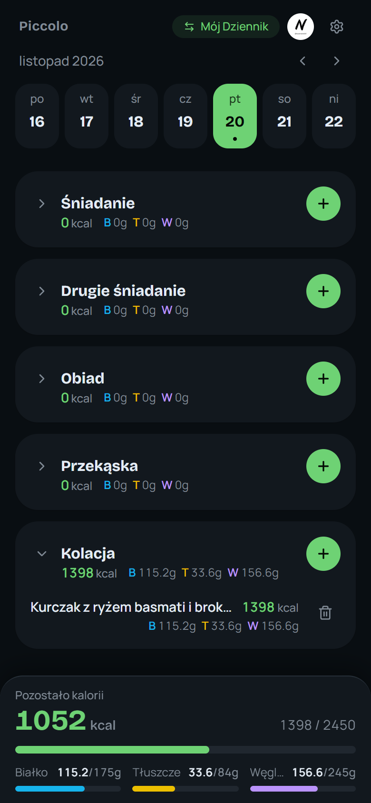
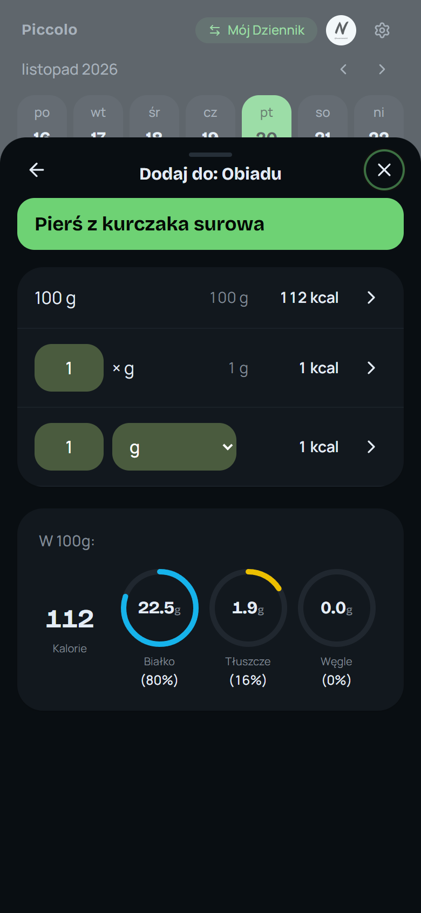
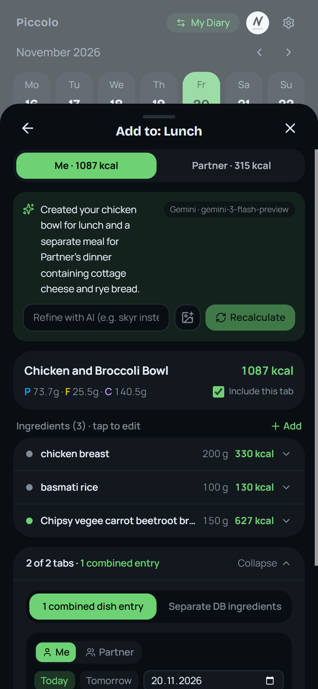
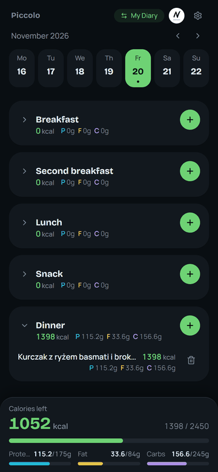
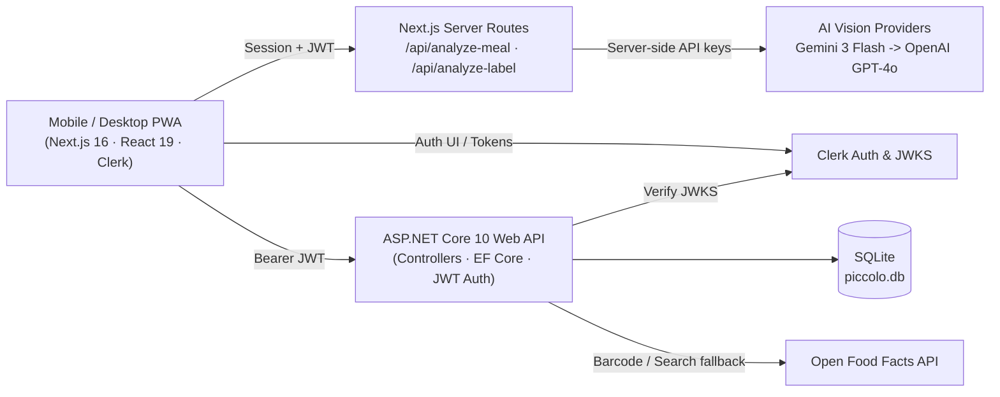

# Piccolo

[](https://github.com/kwasniewskin/Piccolo/actions/workflows/ci.yml)
[](https://dotnet.microsoft.com/)
[](https://nextjs.org/)
[](https://www.typescriptlang.org/)
[](LICENSE)

> **Mobile-first calorie and macro diary** featuring a multimodal AI meal assistant, real-time 1:1 partner sync, barcode scanning with Open Food Facts fallback, and a multi-source nutrition catalog.

Built as a full-stack personal nutrition platform combining a **Next.js 16 + TypeScript** PWA frontend with an **ASP.NET Core 10 + EF Core (SQLite)** REST API, secured by **Clerk JWT** authentication and backed by **71 automated integration and UI tests**.

---

## Preview

| Daily Diary & Macro Progress | Serving Units & 100g Breakdown | Multi-Meal AI Tabs & Partner Split | AI Meal Assistant Flow |
| :---: | :---: | :---: | :---: |
|  |  |  |  |

---

## Key Features

* **Multimodal AI Meal Assistant & Label OCR** (`Gemini` + `OpenAI` fallback)
  * Parse natural-language meal descriptions, recipes, handwritten notes, or nutrition label photos into structured ingredients with live macro recalculation.
  * Automatically separates multi-plate or multi-meal inputs into independent tabs, supports iterative AI refinement (`Refine with AI`) and single-ingredient recalculation in the active UI language (`en` / `pl`), and matches ingredients against the local product database before creating new entries.
  * Save either as a single combined dish entry or as individual database entries split across portions, dates, and partner diaries.
* **Hybrid Food Catalog & Barcode Scanner**
  * Local SQLite catalog enriched via a custom Python ETL pipeline combining **CIQUAL**, **USDA**, and **Open Food Facts** datasets, plus Polish diacritic normalization and 90-day personal usage frequency ranking.
  * Camera barcode scanning (`react-zxing`) with automatic Open Food Facts lookup and one-tap local import.
* **Partner Sync (1:1 Shared Diary)**
  * Pair two accounts using single-use 6-digit codes with a 15-minute TTL.
  * View and log meals into your partner's diary while preserving an explicit `CreatedByUserId` audit trail on every entry.
* **Serving Units, Custom Goals & Historical Integrity**
  * Per-product serving units (`portion`, `package`, `slice`, `spoon`, etc.) with personal recently-used serving quick rows.
  * Daily kcal and macro targets persisted per user, language-aware Open Food Facts lookups (`lc=en` / `lc=pl`), full English / Polish UI localization, and installable PWA configuration.

---

## System Architecture



---

## Engineering Highlights & Tradeoffs

1. **Cascading Multimodal AI Provider ([ai-provider.ts](frontend/src/lib/ai-provider.ts))**
   * *Decision:* Route all vision/JSON calls through Next.js server routes with a prioritized model chain (Gemini models first, automatic fallback to OpenAI `gpt-4o` / `gpt-4o-mini` on `429`/`503` or parse failure).
   * *Tradeoff:* Keeps provider API keys strictly server-side and prevents single-provider rate limits from breaking meal logging, at the cost of maintaining strict JSON normalization in [analyze-meal/route.ts](frontend/src/app/api/analyze-meal/route.ts).
2. **Nutrition Snapshots on Diary Entries ([DiaryEntry.cs](backend/Piccolo.Api/Models/DiaryEntry.cs))**
   * *Decision:* Snapshot `ProductName`, `KcalPer100g`, `ProteinPer100g`, `FatPer100g`, and `CarbsPer100g` at the moment an entry is logged.
   * *Tradeoff:* Slightly denormalizes `DiaryEntries`, but guarantees that editing or updating a product in the catalog never retroactively alters historical calorie logs.
3. **Local-First Search Ranking with Personal History Boost ([ProductsController.cs](backend/Piccolo.Api/Controllers/ProductsController.cs), [SearchTextHelper.cs](backend/Piccolo.Api/Services/SearchTextHelper.cs))**
   * *Decision:* Query and score normalized local products first (boosting verified items and foods logged by the user in the last 90 days) before falling back to Open Food Facts.
   * *Tradeoff:* Keeps search latency predictable even on SQLite while surfacing relevant local foods immediately without external network dependency.
4. **Isolated Full-Stack Test Harness ([CustomWebApplicationFactory.cs](backend/Piccolo.Api.Tests/Helpers/CustomWebApplicationFactory.cs))**
   * *Decision:* Replace file-backed SQLite, Clerk JWKS validation, and live Open Food Facts HTTP calls with an in-memory SQLite connection, `TestAuthHandler`, and `MockOpenFoodFactsService` in xUnit, and mock `fetch`/Clerk in Vitest.
   * *Tradeoff:* Enables deterministic, zero-secret CI runs across all 71 tests in seconds.

---

## Tech Stack

| Layer | Technologies |
| :--- | :--- |
| **Frontend** | Next.js 16 (App Router), React 19, TypeScript 5.7, Tailwind CSS 4, `lucide-react`, `sonner`, `react-zxing` |
| **Backend** | ASP.NET Core 10, Entity Framework Core 10, SQLite, JWT Bearer Authentication |
| **Auth & AI** | Clerk (`@clerk/nextjs` + JWKS verification), Google Gemini Vision API, OpenAI Vision API |
| **Data & ETL** | Python 3 ETL pipeline (`tools/catalog-etl/`), C# `CatalogImporter` CLI, Open Food Facts API |
| **Testing & CI** | xUnit + `WebApplicationFactory` (51 tests), Vitest + React Testing Library (20 tests), GitHub Actions |

---

## Testing

All suites run completely offline with mocked external dependencies:

```bash
# Backend integration tests (51 xUnit tests)
dotnet test backend/Piccolo.Api.Tests

# Frontend typecheck & unit/component tests (20 Vitest tests across 6 files)
cd frontend
npm run typecheck
npm test
```

---

## Local Setup

### Prerequisites
* [.NET 10 SDK](https://dotnet.microsoft.com/download)
* [Node.js 20+](https://nodejs.org/) & `npm`
* A free [Clerk](https://clerk.com/) application and at least one AI key (`GEMINI_API_KEY` or `OPENAI_API_KEY`) for AI features

### 1. Clone & configure Backend
```bash
git clone https://github.com/kwasniewskin/Piccolo.git
cd Piccolo/backend/Piccolo.Api

cp appsettings.Example.json appsettings.Local.json
# Edit appsettings.Local.json and set your Clerk Authority URL

dotnet restore
dotnet ef database update
dotnet run --launch-profile http
```
The API listens on `http://localhost:5022`.

### 2. Configure & run Frontend
```bash
cd ../../frontend
cp .env.example .env.local
# Edit .env.local with your Clerk keys and GEMINI_API_KEY / OPENAI_API_KEY

npm install
npm run dev
```
Open [http://localhost:3000](http://localhost:3000).

---

## Project Structure & Documentation

```text
├── .github/workflows/ci.yml      # Automated backend + frontend CI checks
├── backend/
│   ├── Piccolo.Api/              # ASP.NET Core 10 API (Controllers, Models, Services, Import, Migrations)
│   └── Piccolo.Api.Tests/        # 51 xUnit integration tests with in-memory SQLite
├── frontend/
│   └── src/
│       ├── app/                  # App Router pages + AI route handlers (/api/analyze-meal, /api/analyze-label)
│       ├── components/tracker/   # Diary UI, AddFoodSheet, AiMealAssistant, BarcodeScanner
│       └── lib/                  # AI provider fallback, nutrition math, API client, i18n
├── tools/catalog-etl/            # Python ETL scripts for multi-source food catalog generation
└── docs/                         # Technical docs & UI screenshots
```

Additional documentation in `docs/`:
* [Authentication Setup (Clerk + JWT)](docs/AUTHENTICATION.md)
* [Partner Sync Architecture](docs/PARTNER_SYNC.md)
* [Backend API Summary](docs/BACKEND_SUMMARY.md)
* [Frontend–Backend Integration Notes](docs/INTEGRACJA.md)
* [PWA Mobile Installation Guide](docs/PWA_INSTALL.md)
* [Barcode Matching Design Notes](docs/TODO_BARCODE_MATCHING.md)

---

## License

Distributed under the MIT License. See [LICENSE](LICENSE) for details.
